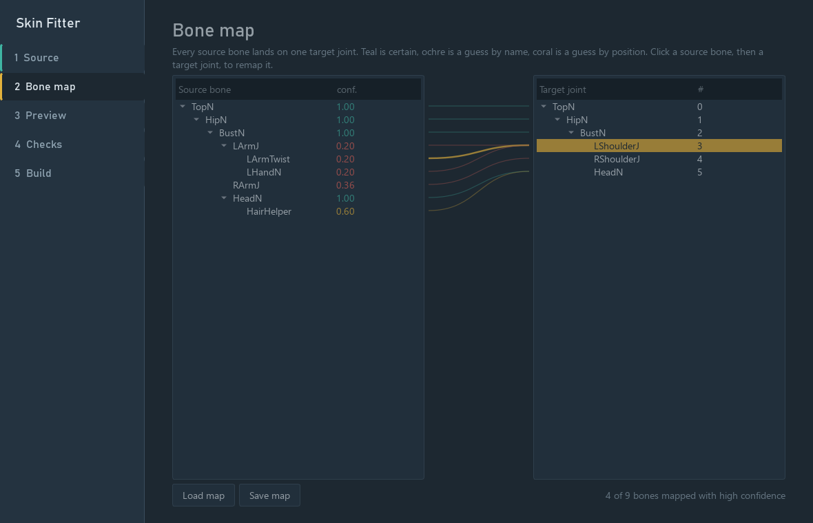
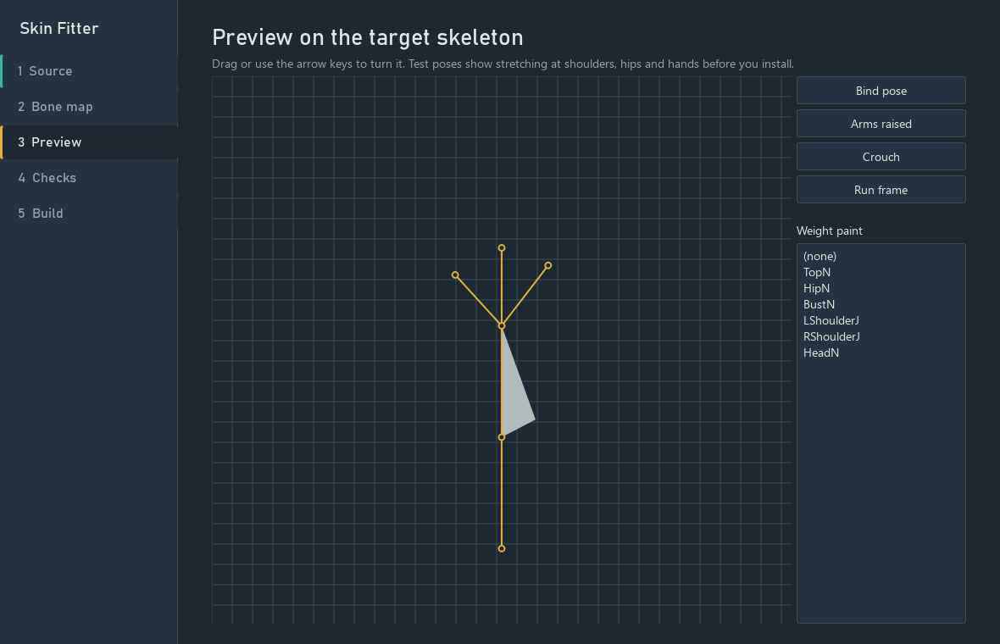
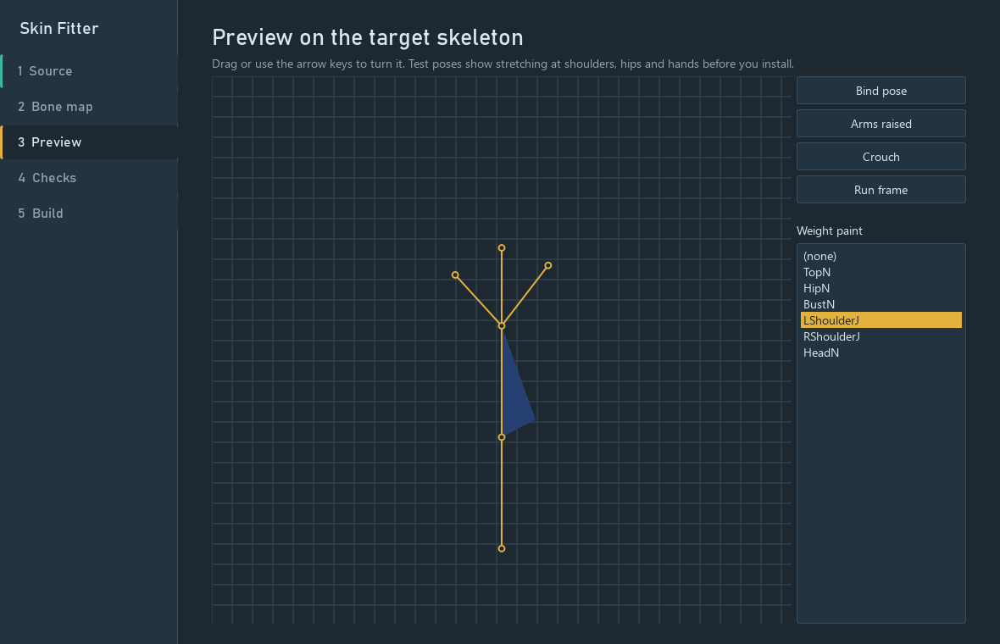
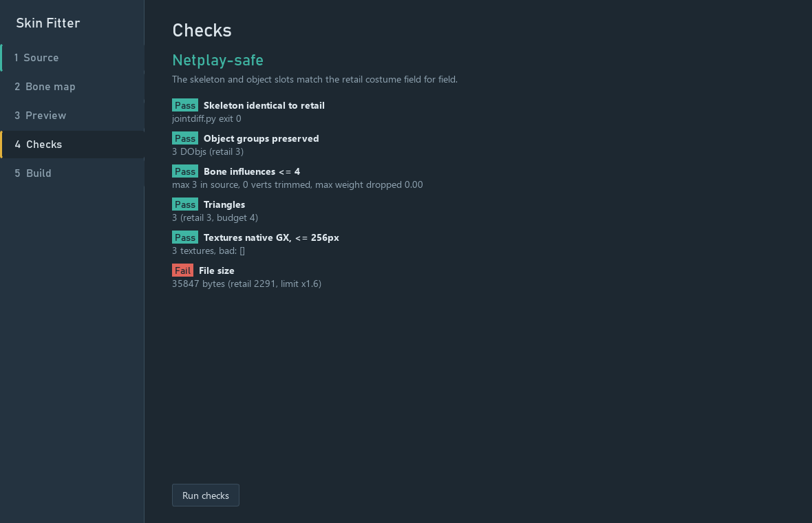

# Skin Fitter

Skin Fitter converts a Super Smash Bros. Brawl costume (from your own disc, or a community skin file) into a new
costume file for a Super Smash Bros. Melee fighter. It fits the Brawl model onto the retail Melee fighter's
skeleton: only the meshes, skin weights and textures change. The retail joint tree and object slots are copied
unchanged, so a converted skin cannot change gameplay and stays netplay-safe (`AUDIT_costume_reads.md` explains
why; `jointdiff.py` proves it for each file built).

Licence: GPL-3.0-or-later (see `LICENSE`, `THIRD_PARTY.md`, `LICENSING.md`).
Copyright (C) 2026 GD (Gurekam Dhillon).

## Legal note

- **Bring your own discs.** This repository contains no game data: no models, textures, costumes, disc-derived
  tables or screenshots of game art. Everything the tool reads comes from files you supply.
- Converted costumes are for your personal use. Do not redistribute files made from game data you do not own the
  rights to.
- The bone-map and role tables that depend on the games (`<fighter>.bones.json`, `<fighter>.roles.json`) are **not
  shipped**. The tool generates them on first use from your own files into your user data folder (below).

## The flow

The front door (`python frontdoor.py`) takes you through it one step at a time:

1. **Pick a source**: a Brawl disc image or an extracted Brawl folder, or a community skin build
   (`pf/fighter/<name>/Fit<Name>NN.pac|.pcs`).
2. **Unpack**: a disc image is unpacked with DolphinTool (`unpack_disc.py`; DolphinTool is a separate program
   you install, see Requirements).
3. **Pick the Brawl character.**
4. **Pick the skin** (costume). Triangle, bone, object and texture counts are shown.
5. **Pick the Melee fighter.** It is pre-selected from the source's own name (`FitLuigi00.pac`, a `fighter/luigi/`
   folder); without a usable name, from bone names. Clones share a skeleton, so when two fighters score within 0.1
   both are shown and the step says "Needs review".
6. **Pick the slot**: add as a new m-ex costume, or replace one of the fighter's colours.
7. **Convert.** Runs `skin.py build` and shows the pass/fail checks and the netplay verdict ("Needs review" when the
   automatic slot or bone mapping is unsure).

"Set Melee disc" points the tool at your Melee disc image (stored in `%APPDATA%/SkinFitter/settings.json`; paths
are never logged). The advanced window (`python ui.py`) shows the bone map, a preview with test poses and weight
paint, the checks, and batch builds.

## Requirements

- Python 3.10+ with `pip install -r requirements.txt` (NumPy; PySide6 for the windows).
- .NET 8 SDK (for `costumebuild`).
- Windows with Visual Studio 2022+ or the VS Build Tools (".NET desktop" workload, .NET Framework 4.7.2 targeting
  pack) for the Brawl reader: BrawlLib targets .NET Framework 4.7.2 and its resources need the full MSBuild.
- Git (dependencies are git submodules).
- Optional: Dolphin's `DolphinTool` to unpack disc images (found from `SKIN_DOLPHINTOOL`, `PATH`, or the usual
  Dolphin install folders). It is a separate GPL-2.0-or-later program and is not distributed with Skin Fitter.

## Build

```
git clone <this repo> skin-fitter && cd skin-fitter
.\build.ps1                    # fetches deps/HSDLib and deps/BrawlCrate at the recorded commits, builds everything
python test_synthetic.py       # end-to-end test on made-up data
python frontdoor.py
```

`build.ps1` does: `git submodule update --init` (HSDLib, BrawlCrate), `dotnet build costumebuild`, and MSBuild of
`brawlreader/model_export` and `brawlreader/brawl_matdump` against BrawlLib built from source. Nothing prebuilt is
committed. `build.sh` builds `costumebuild` on any OS (`--brawl` also runs the Windows step).

**Using your own BrawlLib** (LGPL-3.0 §4): either `.\build.ps1 -BrawlLibProject C:\path\BrawlLib.csproj`, or
replace `brawlreader\bin\Release\net472\BrawlLib.dll` with your own build of a compatible BrawlLib.

## Where things go

| what | where | override |
|---|---|---|
| generated bone maps and role tables | `%LOCALAPPDATA%\skin-fitter\maps` (Linux: `~/.local/share/skin-fitter/maps`) | `SKIN_FITTER_DATA` |
| scratch folders | `<data>\work` | `SKIN_FITTER_WORK`, or `skin.py build --work` |
| installed costumes (default) | `<data>\mods` | the "Mods folder" field, `--install DIR` |
| Melee disc image | front door settings | `SKIN_MELEE_IMAGE` (`GW_ISO_VANILLA` also read) |
| helper executables | `costumebuild\bin\...`, `brawlreader\bin\...` | `SKIN_COSTUMEBUILD`, `SKIN_MODEL_EXPORT` |

First use: when a Melee image is set, `autogroups.py tables` writes `<fighter>.roles.json`, and with an unpacked
Brawl `fighter/` folder `make_templates.py --brawl <folder>` writes `<fighter>.bones.json`, both into the data
folder. You can run them by hand too. `maps/luigi.groups.example.json` (shipped) shows the slot-config format.

## Command line

```
python skin.py fetch  --fighter luigi --costume Nr --out <dir>          # PlCo.dat + PlLgNr.dat from SKIN_MELEE_IMAGE
python skin.py build  --source <Brawl fighter folder | .pac | .pcs | source.json> --fighter luigi \
       --retail <dir>/PlLgNr.dat --plco <dir>/PlCo.dat --fighter-dat <dir>/PlLg.dat \
       --out <out>/PlLgXx.dat [--groups groups.json] [--map map.json] [--install <mods> --name "Skin"] [--slot Gr]
python skin.py target | automap | retarget | batch | detect ...          # the individual steps
python jointdiff.py PlLgNr.dat PlLgXx.dat                                # exit 0 = skeleton and non-visual fields identical
# a colour file made with --slot Gr is compared with retail PlLgGr.dat (build does this when that file sits next to --retail)
```

`build`, in order: exports the `.pac` with `model_export`; reads the retail costume and names its joints from PlCo;
auto-maps bones (map entries win, then same name 1.0, synonym 0.85, nearest joint by position 0.2-0.6);
retargets (weights summed per target joint, cut to 4, renormalised; mesh re-posed per bone, `--repose aim|rigid|none`;
a slot config may list `repose_inherit` bones that ride with their parent); writes the costume with `costumebuild`
(retail JObjs, MObjs and TObj chains kept, DObj slots `replace`/`keep`/`blank`, textures over 256 px downscaled to
CMPR or RGB5A3, CI4/CI8 palettes kept); runs the checks and `jointdiff`; with `--install`, copies the file into
`<mods>/<name>/files/` with a `mod.json` (`--slot` renames it to that colour file and retags its symbols, then runs
`jointdiff` against that colour's retail file `Pl<code><slot>.dat` when it is next to `--retail`).

Layered materials (Brawl eyes: lids, iris and white on UV sets 0 to 3) are found from the material's texture
coordinates and baked automatically into one static texture in UV-set-0 space; the checks list
"eyes baked from N layers; static, no blink". `--no-bake-eyes` turns this off (only the first texture is used).

Without `--groups`, `autogroups.py` assigns source objects to retail slots from the fighter data file.

## Files

| file | what it does |
|---|---|
| `skin.py` | CLI core: `target`, `automap`, `retarget`, `build`, `batch`, `detect`, `fetch` |
| `frontdoor.py` | the step-by-step window |
| `ui.py` | the advanced window (bone map, preview, checks, build, batch) |
| `autogroups.py` | slot roles and object-to-slot assignment; `tables` generates role tables |
| `make_templates.py` | generates bone-map templates from your Brawl + Melee files |
| `brawl_root.py`, `unpack_disc.py` | find the Brawl fighter folder; unpack a disc image with DolphinTool |
| `jointdiff.py` | byte-level comparison of joint trees and non-visual fields |
| `coverage.py` | reads the structure of all 26 Melee fighters (names and counts) into a report |
| `paths.py` | repo, user data, work and tool locations |
| `mex_hsd.py`, `melee_fighters.py` | GCM/HSD readers and the fighter table (vendored from the author's own tools) |
| `mexcostume/` | the m-ex costume step: C# tool (`cs/`, on HSDRaw) + Python wrapper; tests in `tests/` and `test_mexcostume.py` |
| `costumebuild/` | C# on HSDLib: `build`, `inspect`, `synth` |
| `brawlreader/` | C# on BrawlLib: `model_export` (Brawl model to JSON), `brawl_matdump` (material dump) |
| `tools/bake_eyes.py`, `tools/cmpr.py` | optional: bake Brawl's layered eye textures into one static texture |
| `test_synthetic.py` | end-to-end test on made-up data |
| `deps/` | git submodules: HSDLib, BrawlCrate (BrawlLib) |

## m-ex costume rows

```
mexcostume\csin\Release
et8.0\mexcostume.exe list    <build> [--fighter-file PlLg.dat] [--json]
mexcostume.exe verify  <build>
mexcostume.exe add     <build> --fighter-file PlLg.dat --costume PlLgXa.dat [--like 0] [--reuse-images]
mexcostume.exe replace <build> --fighter-file PlLg.dat --row 6 --costume PlLgXa.dat
mexcostume.exe remove  <build> --fighter-file PlLg.dat            (last row, added by this tool)
mexcostume.exe undo    <build> [--force]
```

`<build>` is an extracted m-ex disc (`sys/`, `files/`). Before any edit the build must pass `verify`; the tool then
writes `<build>/skinfitter-undo/<time>-<op>/` (manifest and backups of every file it will change), edits
`MxDt.dat` (row, costume count, runtime block), `MnSlChr.usd` (portrait key) and `IfAll.usd` (stock key), copies the
costume in, re-reads and re-verifies, and rolls back on any failure. The front door does this in the slot step when
"Add as a new m-ex costume" is chosen and an m-ex build folder is given (`mexcostume.add_costume` renames the file to a
free `Pl<code>X?.dat` and retags its symbols).

## Checks and limits

| check | limit | why |
|---|---|---|
| skeleton | bit-identical to retail | gameplay reads joints (`AUDIT_costume_reads.md`) |
| object slots | same DObj count, order and owning joint | part-visibility tables index them |
| influences | at most 4 per vertex; fails if more than 0.25 of a vertex's weight is dropped | HSD envelopes |
| textures | native GX formats, at most 256 px per side | console texture memory |
| triangles, file size | at most 1.6x the retail costume, counted over the whole costume (kept and blanked slots included) | conservative heap headroom; not a measured console maximum |

## Known limits

- **Eyes do not blink.** Retail animated eye slots are blanked and the source eyes are static. Layered Brawl eyes are
  baked automatically into one image (the composite order, top layer first in the material, was checked against
  one real fighter; `tools/bake_eyes.py` remains as the manual version).
- **Winding reversal is opt-in** (`SKIN_REVERSE=1` for `costumebuild`); the old default turned real Brawl meshes
  inside out.
- **m-ex costume rows** (`mexcostume`) work on an *extracted* m-ex build of the MexManager layout only; other
  layouts (e.g. mexTool-era builds) are refused. A new row gets a copy of an existing costume's portrait and stock
  icon (or reuses them with `--reuse-images`); importing new portrait/icon art is not implemented yet. Only the last
  row, and only one this tool added, can be removed. HSDRaw re-lays-out the three archives it saves, so after
  add + remove the files are structurally equal to the original but not byte-identical; `undo` is byte-identical.
- Fist and low-detail slots are inferred from skin weights, not from the animation files; check "Needs review"
  results in the advanced window.

## Tests

`python test_synthetic.py [workdir]` builds a made-up retail costume (`costumebuild synth`) and a made-up 9-bone
source rig, and checks auto-mapping, weights, re-posing, CI8 palettes, texture downscaling, alpha test, DObj slots,
`jointdiff` (pass on output, fail on a tampered copy), compressed community-skin files and autogroups. It uses a
temporary data folder and reads no game files. One "FAIL file size" line in its output is expected (the tiny
synthetic retail file makes the size check trip; the test asserts that). It also covers fighter detection by name
and the near-tie "Needs review" case, and a 4-UV-set layered eye. `python test_mexcostume.py` runs the m-ex tests.

Screenshots in `docs/` show only the synthetic test model.

   
